

  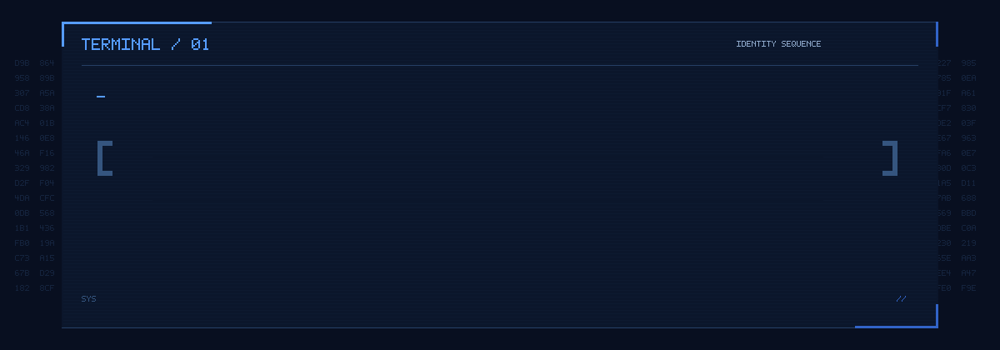

  Hi, I'm <strong>Diego</strong>. Welcome to my space for projects and development.
   
  <a href="#about-me">About Me</a> ·
  <a href="#where-to-find-me">Where to find me</a> ·
  <a href="#what-do-i-do">What do I do</a> ·
  <a href="#featured-projects">Projects</a> ·
  <a href="#tech-stack">Tech Stack</a>

<!-- DRAFT FOR REVIEW: confirm bio, technologies, and contact details before publishing. -->

  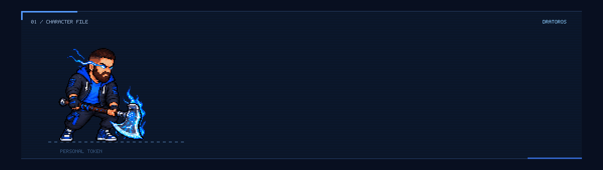

I'm Diego, also known as **Dratoros** — a developer focused on **databases, backend systems, and data analytics**. I connect systems, automate workflows, and turn data into practical business solutions.

  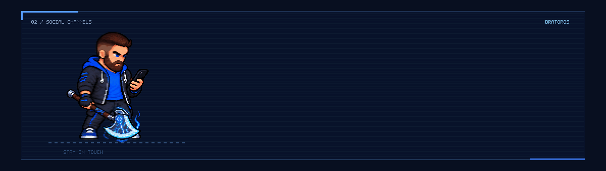

<!-- CONTACT BUTTONS: generated by scripts/generate_contacts.py -->

  
  
   
  
  

<!-- /CONTACT BUTTONS -->

  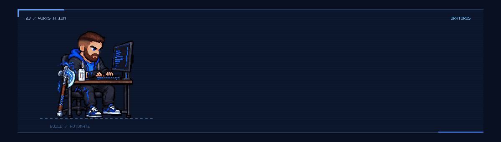

- 🗄️ Database administration & data modeling
- ⚙️ Data pipelines, ETL & workflow automation
- 📊 Dashboards & business intelligence
- 🔗 Backend APIs & event-driven integrations
- 🛠️ Business applications & access control

  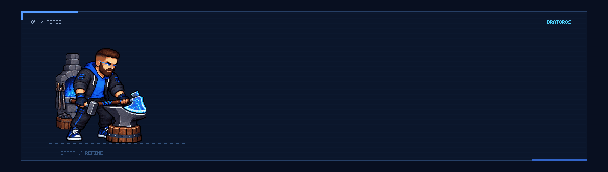

  <a href="https://github.com/Dratoros/erp-integration-platform">
    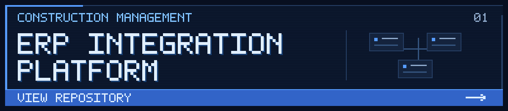
  </a>

A modular construction ERP connecting operations, finance, and a client portal in one application.

`React` `TypeScript` `Supabase` `PostgreSQL`

[**View repository →**](https://github.com/Dratoros/erp-integration-platform)

---

  <a href="https://github.com/Dratoros/toloni-pescarias">
    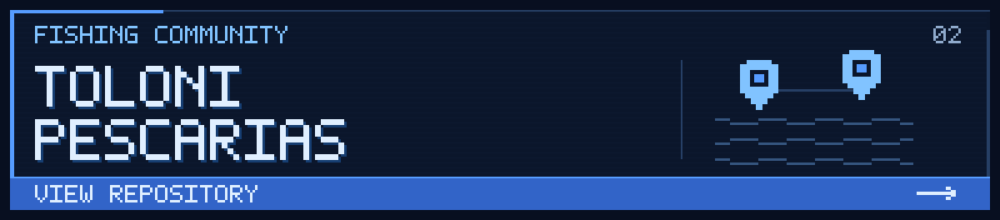
  </a>

A fishing community application for sharing fishing reports, exploring locations, and connecting anglers.

`React` `TypeScript` `Vite` `Tailwind CSS`

[**View repository →**](https://github.com/Dratoros/toloni-pescarias)

## Tech Stack

<!-- TECH STACK: generated by scripts/generate_tech_stack.py -->

### Frontend

  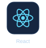
  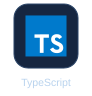

### Backend & Databases

  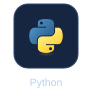
  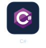
  
  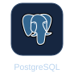
  
  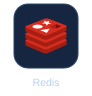
  

### Data & BI

  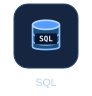
  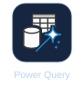
  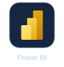
  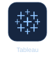

### DevOps, Tools & Automation

  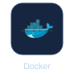
  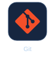
  
  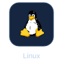
  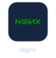
  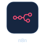

<!-- /TECH STACK -->
